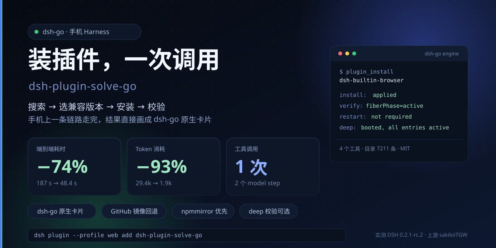

# dsh-plugin-resolver-dshgo



sakikoTGW 的 [dsh-plugin-resolver](https://github.com/sakikoTGW/dsh-plugin-resolver)（0.1.3）在
**dsh-go 手机 harness** 上的适配版。工具名、参数、版本选择规则、安装路径全部沿用上游；
改动只针对“在手机上跑”和“在 dsh-go 里看”。

仓库：<https://github.com/sakikoTGW/dsh-plugin-resolver-dshgo> · 消融数据与问题清单见仓库根目录。

## 改了什么

| 上游行为 | 手机上的问题 | 适配版 |
|---|---|---|
| 输出只有纯文本 | 手机上长报告难读 | 四个工具都带 `presentationMeta` → `dsh-go/view` 卡片：搜索是列表、解析是计划卡、安装是步骤条、状态是清单。文字版原样保留，桌面端不受影响 |
| 安装后提示 `restart DSH fully` / `Ctrl+R` | 这两个操作在 App 里不存在 | 检测到 dsh-go 时改成「在 App 的引擎页重启引擎」「下拉刷新会话」 |
| GitHub 只直连 codeload，代理只能写 profile patch | 手机网络经常连不上 | 支持 `DSH_GITHUB_PROXY`；直连失败自动换 `gh-proxy.com` / `ghfast.top`；成功的下载方式记 7 天，下次先走它 |
| registry 缺省回落 npmjs.org | 手机上容易 90 秒超时 | dsh-go 上缺省回落 `registry.npmmirror.com` |
| profile 推断按 desktop → web | 手机只有 web，顺序反了会读错 | dsh-go 上按 web → desktop |
| `pnpm install` 跳过被 pnpm 11 拦下的构建脚本却不吭声 | 会出现“构建成功但产物坏” | 解析 `Ignored build scripts:`，在文字和卡片里告警；`plugin_install` 的 `pendingBuilds` 也一并提示 |
| 构建超时 20 分钟、下载 5 分钟 | 手机后台易被冻结 | dsh-go 上构建 10 分钟、单次下载 90 秒，失败快速换镜像 |
| 源码构建无沙箱、以 root 执行 | 风险不透明 | 计划卡和安装卡上直接写明，只构建可信仓库 |
| `plugin_status` 把绝对路径加载的 entry 当第三方 | dsh-app 的桥接会混进列表 | 过滤绝对路径 / `cordis:` / `file:` / `node:` |
| `resolvePnpm()` 只认 `DSH_PNPM_PATH` 和 PATH | 部分宿主的 pnpm 不在 PATH | 追加 `/usr/local/bin/pnpm`、`/usr/bin/pnpm`、`/opt/pnpm/bin/pnpm` |

## 装 / 卸

```sh
# 从 GitHub 源安装（推荐，锁 commit）
dsh plugin --profile web add github:sakikoTGW/dsh-plugin-resolver-dshgo#<40位commit>

# 本地开发：装的是指向本目录的链接，别删这个目录
dsh plugin --profile web add /path/to/dsh-plugin-resolver-dshgo/plugin

# 卸
dsh plugin --profile web remove dsh-plugin-resolver-dshgo
```

改 `logic/` 后下一次工具调用就生效；改 `host/register.js` 或 `index.js` 要在 App 的引擎页重启一次。

## 配置（profile 的 `cordis.patch.yml`，可选）

```yaml
- id: plugin-resolver
  config:
    registry: https://registry.npmmirror.com
    githubProxy: https://gh-proxy.com
    catalogTtlMs: 43200000
```

环境变量：`DSH_GITHUB_PROXY`（GitHub 下载前缀）、`DSH_GO=1`（在非 dsh-app 主机上强制按手机处理）、
`DSH_PNPM_PATH`（源码构建用的 pnpm）。

## 深度校验：`verify: "deep"`

默认 `quick`：只读当前 loader 的 `fiberPhase`，并给出“是否要重启”的判定。快，但只能证明“已登记”。

`plugin_install` 传 `verify: "deep"` 时会多做一步：`dsh --profile <p> --dump-config` 确认组合里确实有这个包，
在没有 HMR 的主机上再 `dsh --profile <p> --help` 真启动一次，检查有没有 entry 没激活。代价是 4–30 秒
（干净 profile 约 4 s，带重插件的约 26 s），不消耗模型 token。`web` profile 和带 HMR 的在线主机会跳过启动，
只做组合校验，避免抢占端口。用在“装完必须马上确认能加载”的场合。

## 保留的上游限制

- 同名插件不猜，必须给 `owner=` 或完整 spec；
- 已装插件再装会被管理器拒绝（`already-installed`），换版本要先 `remove`；
- 源码构建仍是“下载 tarball → pnpm install → pnpm run build → link:”，不做 git 克隆；
- 手机上没有沙箱，构建脚本以 root 运行，请只装可信仓库；
- `plugin_install` 是单次阻塞调用，最长 20 分钟（构建子步骤 10 分钟）。

## 卡片长什么样

```text
插件目录 · browser        安装计划                装插件
目录 7211 条 · 缓存       包 dsh-builtin-browser   包  dsh-builtin-browser
1. BrowserSkill  ★9.6k    Registry npmmirror       结果 已生效
2. browser-mcp   …        当前内核 0.2.1-rc.2      ① 解析 ② 安装 ③ 校验 ④ 重启
```

License 沿用上游 MIT；上游作者 sakikoTGW。
